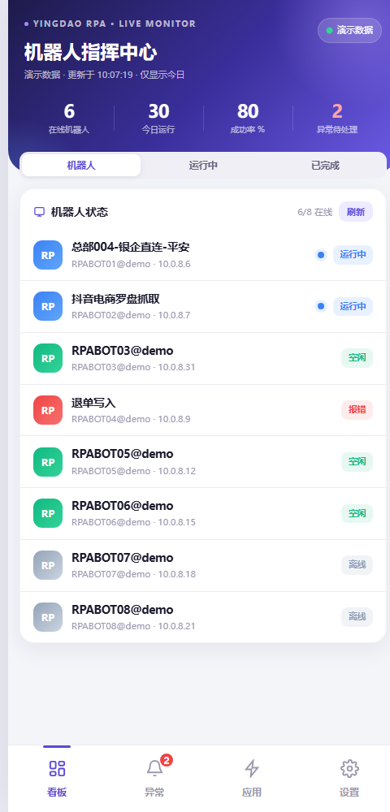
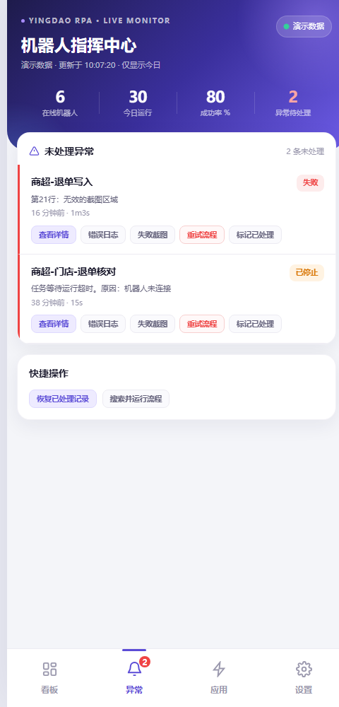
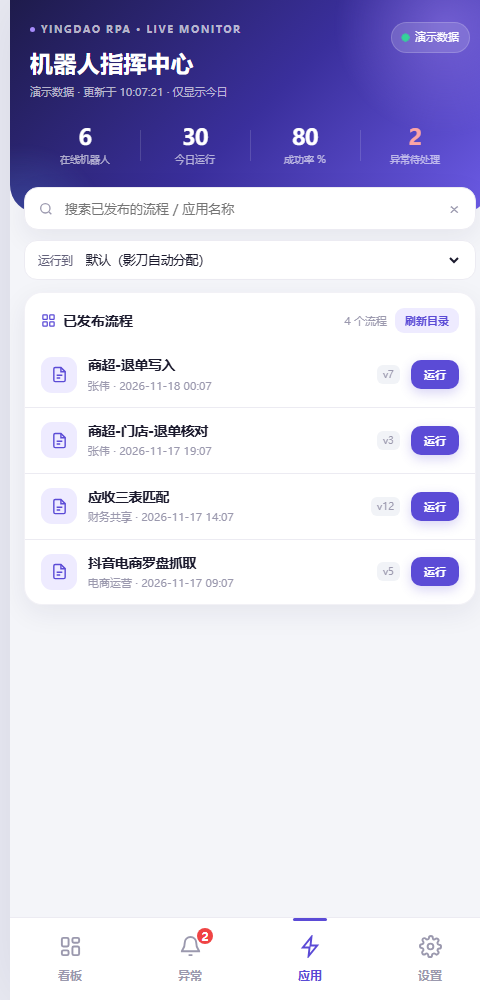
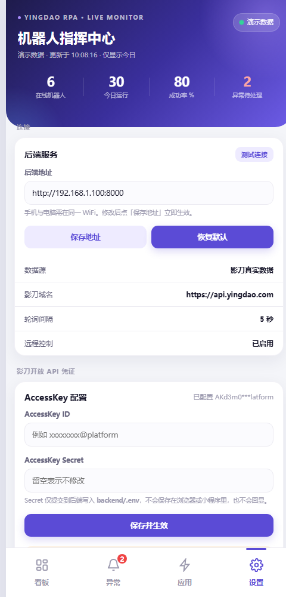

# 影刀 RPA 机器人监控

[](https://github.com/Cyxiaobin/yingdao-robot-monitor/actions/workflows/ci.yml)
[](LICENSE)

一个跑在自己服务器上的小服务，把影刀（ShadowBot）里机器人的运行情况同步到手机上。

起因很实际：影刀控制台只能开在电脑上，值班时候想知道某条流程跑完没有、失败是什么原因，得回工位。这个项目就是把这部分搬到手机。



手机不直接连影刀，中间隔一层自己的后端：

```
微信小程序 ─┐
            ├─ WebSocket / REST ─→ 后端(FastAPI) ─→ 影刀开放 API
浏览器看板 ─┘                      5 秒轮询 + 终态回调
```

好处是影刀的 `accessKeySecret` 只存在你自己服务器上，小程序和浏览器都拿不到。后端每 5 秒拉一次状态，有变化才往手机推，所以手机端不用一直发请求。

## 能做什么

**看板**

- 概览四个数：在线机器人、今日运行次数、成功率、未处理异常
- 机器人列表，每台显示在线 / 运行中 / 空闲 / 离线
- 三段筛选：机器人、运行中、已完成，同一时刻只显示一段，不混在一起
- 运行记录按时间轴排，点一条展开详情

**异常**

- 失败和超时单独放一个标签页，不用在正常记录里翻
- 每条异常能看错误备注、错误日志、失败当时的截图
- 确认后直接重试
- 处理过的可以标掉，避免每次打开都看到同一批

**远程操作**

- 搜已发布流程，选机器人，启动
- 运行中的流程可以停止
- 所有写操作都要点两次确认，也能用配置一把全关

**账号**

- 登录才能用，密码存加盐哈希，不存明文
- 管理员能加、删普通用户，能重置别人密码
- 普通用户只能看。启动、停止、重试、改密钥这些只有管理员能点，后端会拒

## 界面

<table>
  <tr>
    <td align="center"><b>看板</b></td>
    <td align="center"><b>异常</b></td>
  </tr>
  <tr>
    <td></td>
    <td></td>
  </tr>
  <tr>
    <td align="center"><b>应用（搜索并运行流程）</b></td>
    <td align="center"><b>设置</b></td>
  </tr>
  <tr>
    <td></td>
    <td></td>
  </tr>
</table>

截图用的是演示数据，页面顶部有「演示数据」标记。真实模式会显示实际机器人和流程名。

## 需要什么

- Python 3.10 及以上
- 影刀企业版，并开通平台级 API KEY。位置在影刀控制台 → 高级设置 → API KEY 管理，每个接入系统建一对单独的。社区版接口不通
- 想在手机上用需要微信开发者工具。只想要浏览器看板的话不需要

## 跑起来

### 先看看长什么样

不用装任何东西，浏览器直接打开 `backend/app/board.html`。

页面发现自己是 `file://` 打开的，会自动进演示模式。里面的数据是内联的假数据，但四个标签页、三段筛选、详情抽屉都能点。

### 接真实数据

```bash
cd backend
pip install -r requirements.txt
cp .env.example .env
```

打开 `backend/.env`，把这两行填上：

```ini
YINGDAO_ACCESS_KEY_ID=你的 accessKeyId
YINGDAO_ACCESS_KEY_SECRET=你的 accessKeySecret
YINGDAO_MOCK=0
```

启动：

```bash
python -m uvicorn app.main:app --host 0.0.0.0 --port 8000
```

然后：

- 浏览器打开 `http://localhost:8000`，根路径会跳到 `/board`
- 接口文档在 `http://localhost:8000/docs`
- 健康检查 `GET /health`，返回里能看到当前是不是 mock 模式

第一次会弹登录，默认账号 `admin` / `admin123`。进去之后第一件事是改密码，默认配置下不改密码其他接口会被拦住。

手上没有 key 也能跑。`YINGDAO_MOCK` 留着 `1`，用的就是内置假数据，全部功能都能点。

### 手机上看

1. 微信开发者工具导入项目根目录，`project.config.json` 里已经设好 `miniprogramRoot`
2. 详情 → 本地设置 → 勾上「不校验合法域名」
3. 改 `miniprogram/utils/constants.js` 里的 `dev.restBase`，换成自己电脑的局域网地址。IP 用 `ipconfig` 查 WLAN 那一段
4. 工具栏点「编译」，再点「真机调试」扫码

注意普通「预览」的二维码仍然会校验域名，HTTP 局域网地址会被微信拦掉，得走真机调试。后端开在别的机器上时，记得放行 8000 端口入站。

## 配置

全部写在 `backend/.env`。

| 变量 | 默认 | 说明 |
| --- | --- | --- |
| `YINGDAO_ACCESS_KEY_ID` | 空 | 影刀开放 API 凭证 |
| `YINGDAO_ACCESS_KEY_SECRET` | 空 | 同上，这个绝对不能提交 |
| `YINGDAO_BASE_URL` | `https://api.yingdao.com` | 专有云换成自己的地址 |
| `YINGDAO_MOCK` | `1` | `1` 用假数据，`0` 调真实接口 |
| `SUPER_ADMIN_USERNAME` | `admin` | 第一次建账号库时创建的超管 |
| `SUPER_ADMIN_PASSWORD` | `admin123` | 上线前必须改 |
| `AUTH_REQUIRED` | `1` | 设 `0` 关掉全站登录，只用于本地调试 |
| `ENFORCE_PASSWORD_CHANGE` | `1` | 没改过初始密码时，只允许调改密接口 |
| `ADMIN_TOKEN` | 空 | 改影刀凭证时要额外带的口令 |
| `CALLBACK_TOKEN` | 空 | 影刀回调校验，上线必配 |
| `ALLOW_REMOTE_CONTROL` | `1` | 设 `0` 关掉所有写操作 |
| `STRICT_REAL` | `0` | 设 `1` 时没有凭证直接启动失败，不会偷偷退回假数据 |
| `ENABLE_POLLER` | `1` | 设 `0` 关掉后台轮询 |
| `POLL_INTERVAL` | `5` | 轮询间隔，单位秒 |
| `SESSION_TTL_HOURS` | `12` | 登录态有效期 |

## 接口

| 端点 | 方法 | 说明 |
| --- | --- | --- |
| `/`、`/board` | GET | 看板页面 |
| `/health` | GET | 健康检查 |
| `/api/auth/login` | POST | 登录，返回 12 小时有效的 token |
| `/api/auth/me` | GET | 查登录态 |
| `/api/auth/logout` | POST | 吊销当前 token |
| `/api/auth/password` | POST | 改自己的密码 |
| `/api/auth/users` | GET / POST | 账号列表 / 新建普通用户（管理员） |
| `/api/auth/users/{username}` | DELETE | 删账号（管理员） |
| `/api/auth/users/{username}/reset` | POST | 重置别人密码（管理员） |
| `/api/snapshot` | GET | 全量快照，只含当天 |
| `/ws` | WS | 先推一帧 `snapshot`，之后推 `delta` / `alarm` / `callback` / `control_result` |
| `/api/apps/search` | GET | 搜已发布流程，结果缓存 60 秒 |
| `/api/apps/refresh` | POST | 强制刷新流程目录（管理员） |
| `/api/control/start` | POST | 启动流程（管理员） |
| `/api/control/retry` | POST | 重试异常流程（管理员） |
| `/api/control/stop-by-task` | POST | 停止运行中的应用（管理员） |
| `/api/run/{taskUuid}/detail` | GET | 失败备注和截图地址 |
| `/api/run/{taskUuid}/logs` | GET | 按任务查错误日志 |
| `/api/bot/{uuid}/logs` | GET | 查机器人最近一次运行的日志 |
| `/api/settings` | GET | 当前配置，Secret 不会返回 |
| `/api/settings/test` | POST | 用当前凭证试一次连通性（管理员） |
| `/api/settings/credentials` | POST | 保存凭证并热生效，不用重启（管理员） |
| `/api/callback` | POST | 影刀终态回调入口 |

影刀接口的字段和踩过的坑写在 `docs/字段对照表.md` 里。有几个和直觉不一样：应用列表不是 `dispatch/v2` 而是 `app/open/query/list`；判断「已发布」要看 `publishTime` 有没有值、`appType` 是不是 `app`；`process/detail` 必须传匹配的机器人 uuid，传错返回空数组而不是报错。

## 测试

```bash
cd backend && python -m pytest            # 97 passed
node --test miniprogram/tests/*.test.js   # 54 passed
node miniprogram/tests/static-check.js    # 静态自检
```

后端测试全走 mock，不需要凭证也不联网。覆盖密码哈希、会话过期、登录失败限流、角色 403、回调令牌校验、强制改密、`STRICT_REAL`、账号库原子写。

小程序那边除了常规单测，还有几项用 mock 的 `wx` 真跑一遍 `Page` 生命周期；另外有个静态自检脚本，检查页面四件套是否齐全、`bindtap` 绑的方法有没有真的定义、代码里有没有写死密钥。

CI 每次 push 和 PR 都会跑这三组。

## 部署到服务器

照着 `deploy/` 里的模板改。有几件事不做会留坑：

1. `backend/.env` 里 `SUPER_ADMIN_PASSWORD`、`CALLBACK_TOKEN`、`ADMIN_TOKEN` 都要配，`STRICT_REAL` 设成 `1`
2. Nginx 用 `deploy/nginx.conf.example`。关键是日志格式只记 `$uri`，不要带 `$args`。影刀 token 接口把 Secret 放在 URL query 里，默认格式会把它完整写进 access.log
3. `/ws` 要透传 `Upgrade` 和 `Connection` 头，不然握手失败
4. 用 `deploy/yingdao-monitor.service` 交给 systemd 管，配开机自启和日志轮转，`.env` 权限设 600
5. 小程序正式版必须 HTTPS + wss、域名已备案、后台配好 request 和 socket 合法域名，类目走企业工具。用了 `wx.login` 还要配《用户隐私保护指引》

## 已知限制

- 只能单实例跑。登录态和告警去重计数都在进程内存里，开两个实例互不相通，重启后所有人得重新登录。要水平扩展得先加 Redis
- 概览只统计影刀最近 50 条运行记录，单日跑超过 50 次会低估
- 回调入口没验证过。影刀控制台是否开放「API 执行回调」、回调体长什么样，需要自己拿账号确认。没配之前实时性全靠 5 秒轮询
- 机器人离线时查不到日志。影刀会返回「机器人未连接」，后端降级成 200 加一句原因提示，不会白屏
- 流程目录缓存 60 秒，新发布的流程最多等一分钟，或者点一下刷新

## 说明

这是内部运维工具，不是通用 SaaS。启动、重试、停止这些操作会在你的影刀环境里真的执行，账号发给谁要控制好。

项目跟影刀官方没有关系，只调用它的公开接口。

出问题请开 issue。安全相关的问题看 [SECURITY.md](SECURITY.md)，不要公开披露。

## 许可

[MIT](LICENSE)
